# jb2SM — jubeat memo → StepMania converter

**▶ ツールを開く：<https://yoppyy.github.io/jubeat-to-stepmania/jb2sm.html>**

最終更新：2026-10-16

**jb2SM** は、jubeat の譜面メモ（cosmos memo / sonicy memo などで使われる「memo 形式」）を StepMania の **dance-single（4パネル）用 `.sm` ファイル** に変換するブラウザーツールです。変換結果は、音源に合わせて **StepMania 風レーン** と **jubeat 風 4×4 パネル** で再生して確認できます。

- `jb2sm.html` を1つ開くだけで動きます。インストールやサーバーは不要です。
- 外部ライブラリーは使っていません（HTML / CSS / JavaScript のみ）。
- 入力したデータを外部に送ることはありません。
- ソースには、処理の流れがわかるように日本語のコメントを入れています。

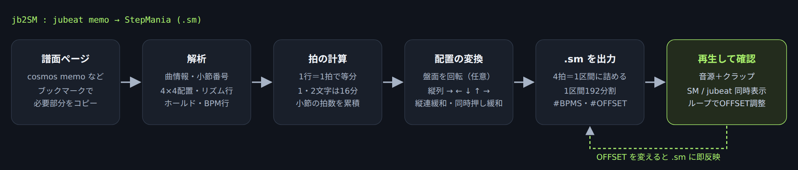

---

## 目次

1. [主な機能](#主な機能)
2. [スクリーンショット](#スクリーンショット)
3. [使い方](#使い方)
4. [入力形式（memo 形式）](#入力形式memo-形式)
5. [処理内容・原理・アルゴリズム（ソース解説）](#処理内容原理アルゴリズムソース解説)
6. [制限事項](#制限事項)
7. [ファイル構成](#ファイル構成)

---

## 主な機能

| 機能 | 内容 |
|---|---|
| **複数難易度** | BASIC / ADVANCED / EXTREME をまとめて貼り付けると、1つの `.sm` に複数の譜面（#NOTES）として入ります。難易度ごとに出力するか・SM の難易度・レベルを選べます。 |
| memo 形式の解析 | 曲情報、小節番号、4×4 のパネル配置、リズム行、ホールドの矢印、譜面途中の `BPM:` 行を読み取ります。 |
| 変拍子 | 小節ごとの拍数（3.5拍・3拍・1拍など）を数え、StepMania の4拍区切りに詰め直します。 |
| BPM 変化 | 譜面中の `BPM: 205` のような行から変化位置を計算し、`#BPMS` に書き出します。 |
| 4パネルへの割り当て | jubeat の盤面を「通常 / 左90度 / 右90度 / 180度」に回転させ、縦の列を ← ↓ ↑ → に割り当てます。 |
| **ホールド** | jubeat のホールドの出し方を4通りから選べます：始点だけタップ（初期値）／始点と終点をタップ／フリーズアロー（同じ列にほかのノーツが重ならない場合だけ、元の長さで）／フリーズアロー・ホールド優先（重なるタップを消して全部フリーズ）。 |
| **縦連緩和** | 16分・24分などの速い縦連（同じレーンの連打）をフリーズアローに置き換えます。 |
| **同時押し緩和** | 3つ以上の同時押しを2つに減らします（←→優先・↑↓優先・←↓優先・↑→優先）。「ホールド最優先」で、ホールドのノーツを先に残します。 |
| 再生プレビュー | 音源（mp3 / ogg / wav）とクラップで再生します。SM / jubeat の同時表示、ハイスピード、Reverse、別ウィンドウ、全画面に対応しています。 |
| OFFSET 調整 | 選んだ小節から何度でも再生し直したり、ループ再生したりしながら ±10ms / ±100ms 単位で合わせます。変更はすぐ `.sm` に反映されます。 |
| サンプル譜面 | 基本・変拍子・BPM変化・ホールド・縦連・同時押し・ホールドに重なるタップ・複数難易度の8種類。読み込むと譜面オプションもそれに合わせて切り替わります。 |
| 画面の配置 | PC では左に「01 譜面を読み込む」、右に「02 曲情報」「03 譜面オプション」（どちらも折りたたみ）と「04 変換・書き出し」を並べ、その下に「05 再生」を置きます。幅 850px 以下では1列になります。 |
| 最終更新日 | ヘッダー右上に表示します。更新したら `jb2sm.html` の `<time datetime="…">` と、この README 冒頭の日付を書き換えてください。 |
| スマホ表示 | 幅 600px 以下では余白を詰め、再生ボタンを再生画面のすぐ下に置きます。タッチ端末ではキー操作の説明の代わりに、タップ操作の説明を表示します。 |
| 取り込み用ブックマーク | 譜面ページで押すと、曲情報と譜面部分だけをクリップボードにコピーします。 |
| ファイル名の自動入力 | 音源は「曲名.mp3 / .ogg」、バナー・背景は `banner.png` / `bg.png` が初期値です。保存する `.sm` のファイル名は「曲名.sm」です。 |

---

## スクリーンショット

### 入力・曲情報（3難易度をまとめて貼り付けた画面例）

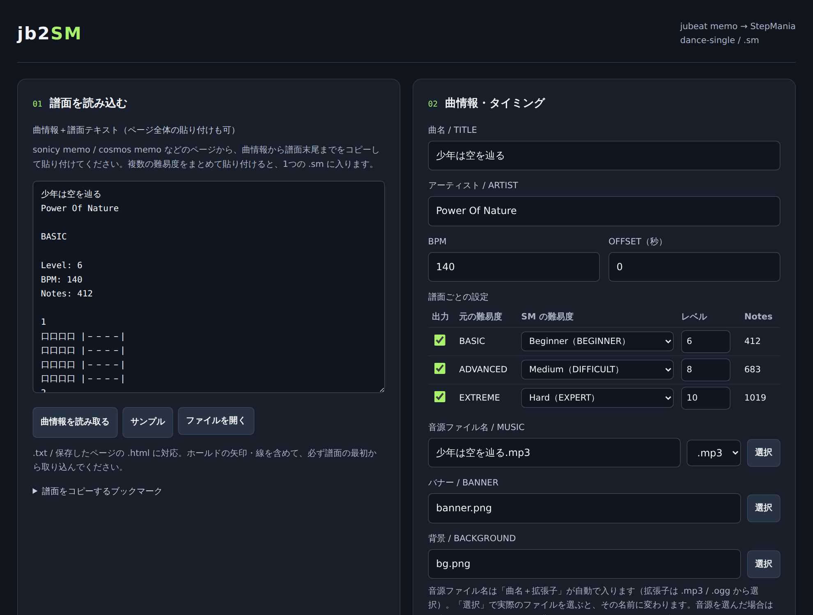

### 変換結果

変換結果には次の情報が出ます。

- 4拍以外の小節の一覧
- 元ページの Notes 数との照合
- 小節ごとの拍数・開始拍・BPM・時刻

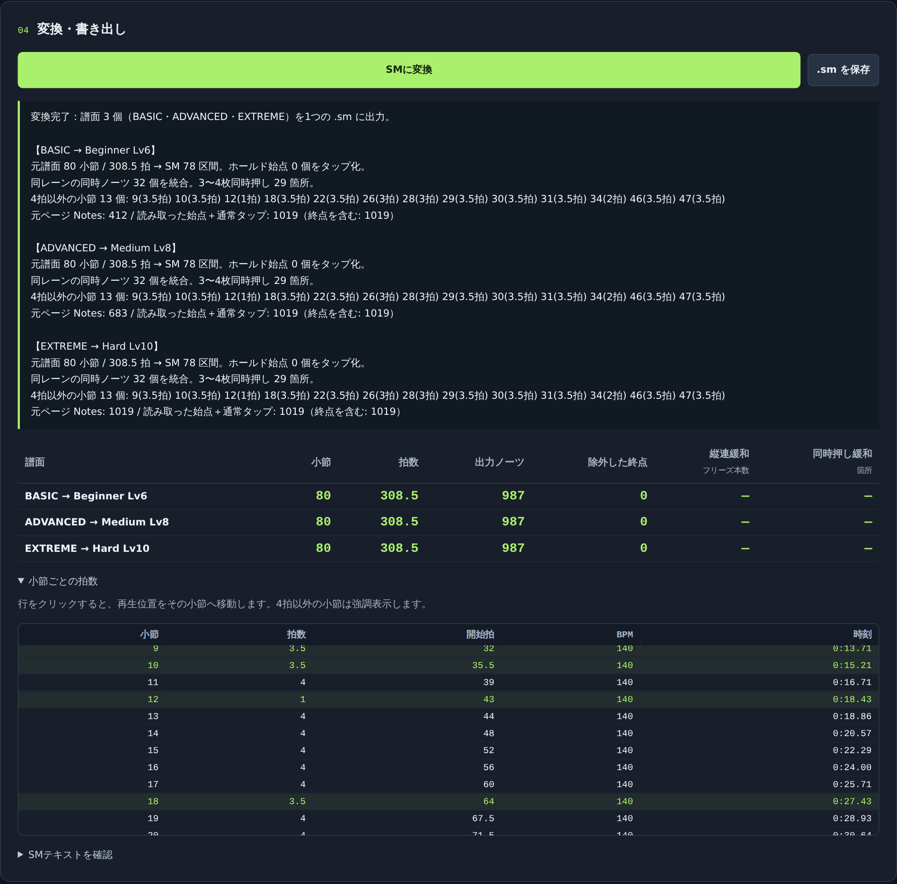

### 再生画面（StepMania＋jubeat 同時表示）

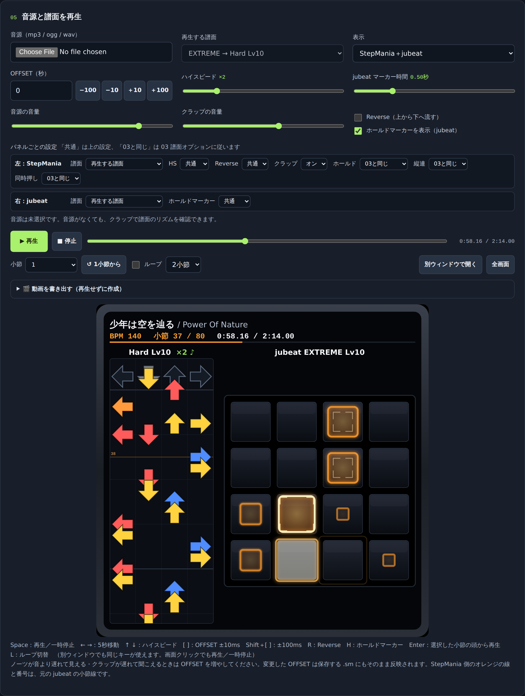

| jubeat のみ | StepMania のみ（Reverse） | 縦連緩和あり（フリーズアロー） |
|---|---|---|
| 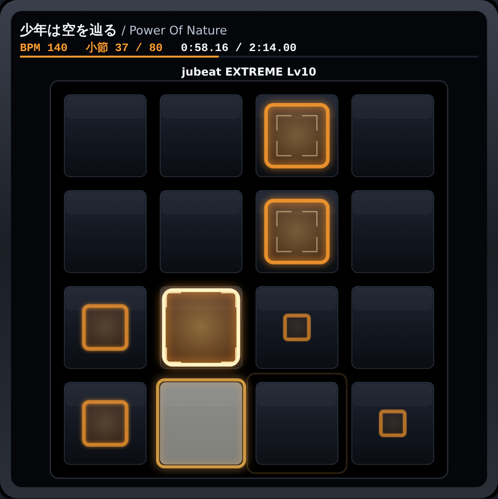 | 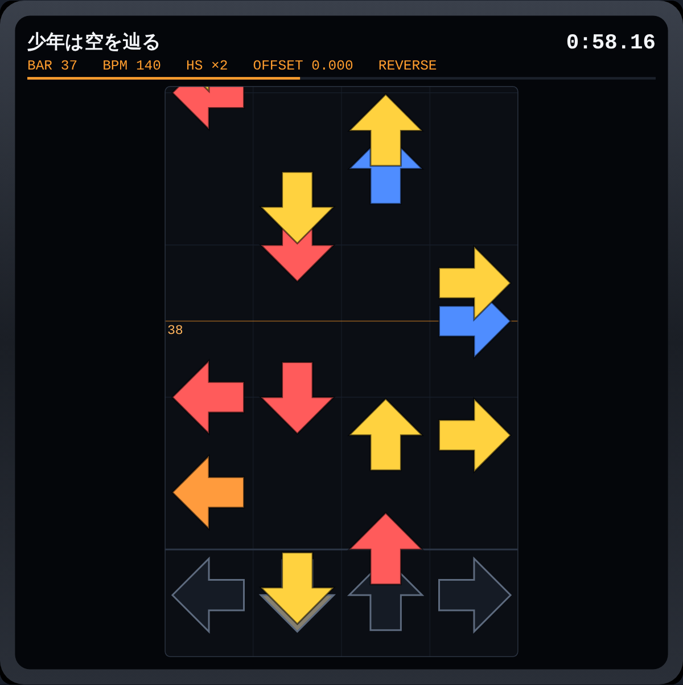 | 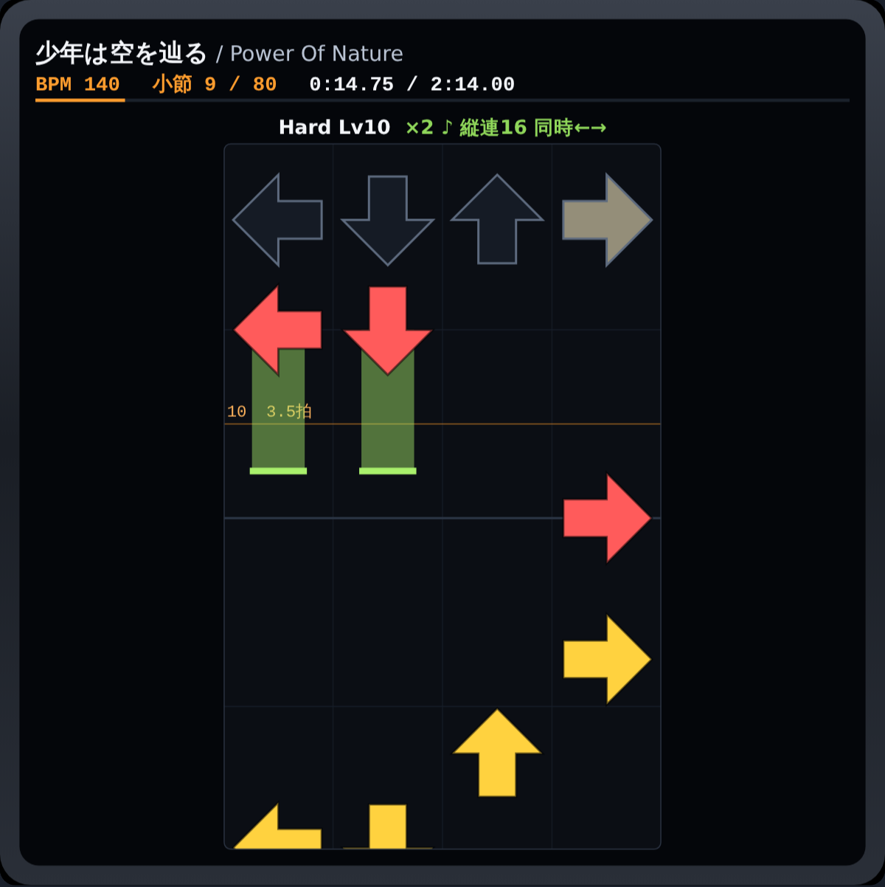 |

### jubeat のホールドマーカー

矢印のあるパネルから始点パネルへ三角のマーカーが進み、届いたときが終点です（左下は縦のホールド ∨、右上は横のホールド ＞――）。

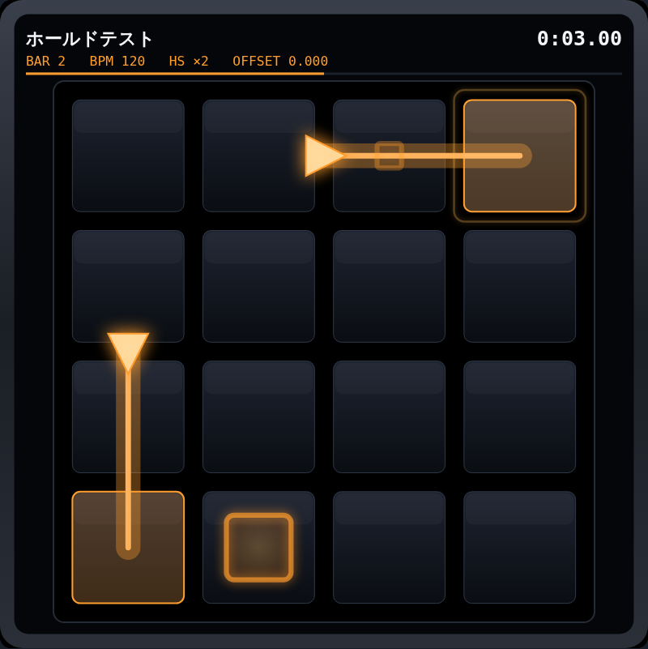

### 譜面オプション（縦連緩和・同時押し緩和・4パネルへの割り当て）

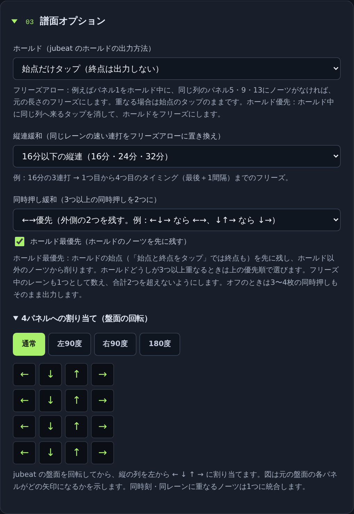

---

## 使い方

### 1. 譜面を取り込む

次の3つのどれかで取り込みます。

- **ブックマーク（おすすめ）**
  1. 「01 譜面を読み込む」→「譜面をコピーするブックマーク」のリンクを、ブックマークバーへドラッグして登録します。
  2. 譜面ページを開いて、そのブックマークを押します。必要な部分だけがクリップボードにコピーされます。
  3. 入力欄に貼り付けます。
- **手動コピー**：ページの曲名から譜面の最後までを選んで貼り付けます。メニューなどが混ざっていてもかまいません。
- **ファイル**：「ファイルを開く」で `.txt` か、保存したページの `.html` を読み込みます。
- **サンプル**：「サンプルを読み込む…」から、場面別の短い譜面を選べます。読み込むと、譜面オプションもそのサンプルに合わせて切り替わり、入力欄の下に何を確かめるサンプルかが表示されます。

| サンプル | 内容 | 切り替わる譜面オプション |
|---|---|---|
| 基本（4分・8分・16分） | 4分・8分・16分と同時押しだけの基本形です。そのまま「SMに変換」してください。 | — |
| 変拍子・3連符・24分 | 3文字の行は3連符（1拍）、6文字の行は24分（1拍）、2文字の行 ｜⑦－｜ は0.5拍です。2小節目は3.5拍になります。 | — |
| BPM変化 | 譜面中の「BPM: 180」の行から、次の小節の頭でBPMが変わります（#BPMS は自動計算）。 | — |
| ホールド（縦・横・交差・隣マス） | 1小節目は縦、2小節目は横、3小節目は交差（╋）、4小節目は隣のマスの矢印です。「ホールド」をフリーズアローにして、jubeat 表示のホールドマーカーも確かめてください。 | ホールド＝フリーズアロー |
| 縦連（16分・24分） | 同じ列の速い連打です。「縦連緩和」を「16分以下」にすると、連打がフリーズアローになります。 | 縦連緩和＝16分以下 |
| 3〜4枚の同時押し | 3枚・4枚の同時押しがあります。「同時押し緩和」で2枚に減ります。2小節目は ↓ がホールドなので、「ホールド最優先」のオン・オフで残る矢印が変わります。 | 同時押し緩和＝←→優先・ホールド＝フリーズアロー |
| ホールド中に同じ列のタップ | ホールド中に同じ列へタップが来ます。「ホールド」をフリーズアローにすると1小節目はタップのまま、「フリーズアロー・ホールド優先」にすると重なるタップを消してフリーズになります。 | ホールド＝フリーズアロー・ホールド優先 |
| 複数難易度（BASIC・ADVANCED・EXTREME） | 3つの難易度をまとめて貼り付けた形です。1つの .sm に Beginner・Medium・Hard の3譜面が入ります。 | — |

サンプルの譜面はすべてこのツールの動作確認用に作ったもので、実在の曲の譜面ではありません。

01 の入力欄が空のあいだは、02〜04 がグレーアウトして操作できません。

貼り付けると、曲名・アーティスト・BPM と、譜面ごとの難易度・レベルが自動で入ります。

**複数の難易度** は、続けて貼り付けるだけで扱えます。たとえばブックマークで BASIC・ADVANCED・EXTREME の各ページを順にコピーして、入力欄に続けて貼り付けます。1ページに複数の難易度があるサイトでは、ブックマークがすべての難易度をまとめてコピーします。譜面は **必ず第1小節から** 取り込んでください（ホールドの終点を正しく判定するため）。

### 2. 曲情報を確認する

「02 曲情報・タイミング」は折りたたまれていて、見出しの下に「曲名 ／ BPM ／ OFFSET ／ 難易度」の要約が出ます。見出しを押すと開きます。曲名や BPM が足りないなど、02 の入力が原因のエラーが出たときは自動で開きます。

| 項目 | 内容 |
|---|---|
| 曲名 / アーティスト | 自動で入ります。編集できます。 |
| BPM | 範囲表記（170-240 など）の曲には、譜面中で最初に出てくる BPM が入ります。 |
| 譜面ごとの設定 | 難易度ごとに1行ずつ表示されます。「出力」のチェック、SM の難易度（Beginner / Easy / Medium / Hard / Challenge）、レベル（SM では四捨五入）を選びます。初期値は BASIC→Beginner、ADVANCED→Medium（DIFFICULT）、EXTREME→Hard（EXPERT）です。同じ SM の難易度を2つの譜面に選ぶとエラーになります。 |
| OFFSET | 秒単位です。正の値にすると譜面が早くなります。再生画面からも調整できます。 |
| 音源 / バナー / 背景 | 初期値は「曲名.mp3（.ogg）」「banner.png」「bg.png」です。「選択」で実際のファイル名に変えられます。 |
| BPM 変化を手入力 | `0=170,256=205` の形式で入力します。自動検出より優先されます。 |

### 3. 譜面オプションを選ぶ（必要なら）

「03 譜面オプション」も折りたたまれていて、見出しの下に今の設定の要約が出ます。開くと **ホールド**・**縦連緩和**・**同時押し緩和** を選べます。その下の折りたたみ「4パネルへの割り当て（盤面の回転）」では、盤面の回転（通常 / 左90度 / 右90度 / 180度）を選べます。

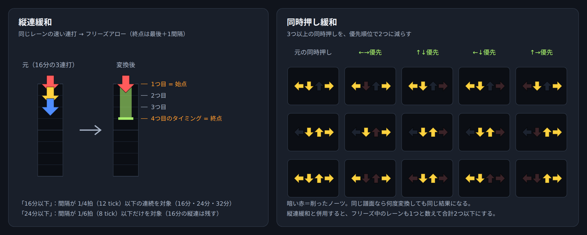

- **ホールド**（jubeat のホールドの出し方）
  - **始点だけタップ**（初期値）：始点をタップにし、終点は出力しません。
  - **始点と終点をタップ**：フリーズは使わず、始点と終点の両方をタップにします。
  - **フリーズアロー**：jubeat のホールドを元の長さのフリーズアローで出力します。
  - ただし、ホールド中に同じ列（同じ矢印のレーン）へほかのノーツが来る場合はフリーズにせず、これまでどおり始点のタップにします。例：パネル1をホールド中に、同じ列のパネル5・9・13にノーツがなければフリーズになります。
  - 同時押し緩和と一緒に使うと、緩和で残った始点だけをフリーズにし、同時に押し続けるフリーズは2本までにします。
  - **フリーズアロー・ホールド優先**：ホールド中に同じ列へ来るタップを消して、ホールドを元の長さのフリーズにします。消したタップの数は集計表の「ホールド」欄に表示します。同じ列のホールドどうしが重なるときは、先に始まるほうをフリーズにします。
- **縦連緩和**
  - 「16分以下」：間隔が 1/4拍以下の縦連（16分・24分・32分）をフリーズにします。
  - 「24分以下」：間隔が 1/6拍以下の縦連（24分・32分）だけをフリーズにします。
  - フリーズの終点は「最後のノーツ＋1間隔」です。たとえば16分の3連打なら、4つ目のタイミングが終点になります。
- **同時押し緩和**：3つ以上の同時押しを2つに減らします。
  - ←→優先の例：←↓→ なら ←→、↓↑→ なら ↓→。
  - 縦連緩和と一緒に使うと、フリーズ中のレーンも1つと数えて、合計が2つを超えないようにします。
  - **ホールド最優先**（初期値オン）：ホールドの始点（「始点と終点をタップ」では終点も）を先に残し、ホールド以外のノーツから削ります。例：← が通常ノーツ、↓ がホールド、→ が通常ノーツの同時押しを ←→優先で減らすと、オフなら ←→、オンなら ←↓ です。「フリーズアロー」と一緒に使うと、ホールドの始点が緩和で消えないので、フリーズが残りやすくなります。

### 4. 変換・保存する

1. 「04 変換・書き出し」の「SMに変換」を押すと、結果と警告、譜面ごとの集計表（小節・拍数・出力ノーツ・除外した終点・縦連緩和のフリーズ本数・同時押し緩和の箇所数）が表示されます。ボタンより下の結果部分は、変換するまでグレーアウトしています。
2. 「.sm を保存」を押すと `曲名.sm`（例：`少年は空を辿る.sm`）がダウンロードされます。
3. StepMania の `Songs/<グループ>/<曲>/` に、`.sm`・音源・バナー・背景を並べて置きます。

### 5. 再生して確認・OFFSET を調整する

「05 音源と譜面を再生」は、「SMに変換」を実行するまでグレーアウトして操作できません。譜面を貼り直したり曲情報を変えたりすると、再びグレーアウトします。

1. 「05 音源と譜面を再生」の「音源」で mp3 などを選びます。02 の音源欄の「選択」で選んだファイルも、そのまま再生に使われます。
2. 複数の譜面があるときは「再生する譜面」で難易度を選びます。再生位置はそのままで切り替わります。
3. 小節を選んで「↺ ○小節から」（Enter）で再生します。
4. 「ループ」をオンにすると、選んだ小節から 1〜8 小節を繰り返し再生します。
5. ノーツやクラップが音より遅いときは OFFSET を増やし、早いときは減らします。

| キー | 動作 |
|---|---|
| Space | 再生 / 一時停止 |
| Enter | 選んだ小節の頭から再生 |
| L | ループの切り替え |
| ← / → | 5秒戻る / 進む |
| ↑ / ↓ | ハイスピード ±0.25 |
| `[` / `]` | OFFSET ±10ms |
| Shift＋`[` / `]` | OFFSET ±100ms |
| R | Reverse の切り替え |
| H | jubeat のホールドマーカー表示の切り替え |

---

## 入力形式（memo 形式）

```
曲名
アーティスト
EXTREME
Level: 10
BPM: 170-240
Notes: 706

BPM: 170          ← 次の小節から BPM 170
1                 ← 小節番号
口口口口 |－－－－|  ← 4×4 配置（4行）＋ リズム行
口口口口 |－－－－|
口口口口 |－－－－|
口口口口 |－－－－|
2
②⑧⑨② |①－②－|
④⑥⑦④ |③－④－|
①口口① |⑤－⑥⑦|
③⑤⑤③ |－⑧⑨－|
```

- **配置**：4文字×4行で1つの盤面です。1小節に複数の盤面が続くこともあります。`口` は空き、`①〜㊵` は押す順番です。
- **リズム行** `|…|`：丸数字が「いつ」押されるかを表します。`－` は休符です。
- **ホールド**：`＞ ＜ ∧ ∨` と線 `―｜` で始点を指します。同じパネルに次に出る番号が終点です。縦（`∧` `∨`）・横（`＞` `＜`）どちらにも対応しています。線どうしが交差するマス（`╋` など）は縦にも横にも通り抜けられるものとして扱い、矢印のすぐ隣が始点のホールド（`①＜` など）にも対応しています。
- 記号がリンク付き（`[①](https://…)` の形）でコピーされた場合も、リンクを外して読み取ります。
- **BPM 行**：`BPM: 数値` だけの行です。次の小節の頭から有効になります。

---

## 処理内容・原理・アルゴリズム（ソース解説）

以下の引用は `jb2sm.html` の `<script>` 部分からのものです。行番号は目安で、説明のために一部を省略・整形している箇所があります。全体の流れは次のとおりです。

```
memo テキスト ─ parseMemo() ─▶ { 小節, ノーツの拍位置, BPM 変化 }
              ─ buildSM()   ─▶ .sm テキスト（縦連緩和・同時押し緩和もここ）
              ─ prepareChart() / play() / renderTo() ─▶ 再生プレビュー
```

用語：**拍** = 四分音符1つ分（曲頭からの累積）／**tick** = 1拍を48等分した単位（SM の1区間＝4拍＝192 tick）／**レーン** = 0:← 1:↓ 2:↑ 3:→／**pos** = jubeat のパネル番号 0〜15。

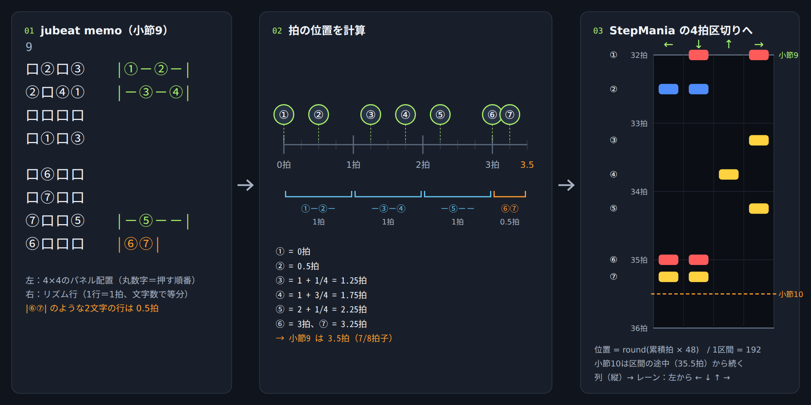

### 1. リズム行 → 拍位置（`parseMemo`、L942 付近）

リズム行1行の長さは、原則 **1拍** で、文字数で等分します。1・2文字の短い行だけは **16分刻み** として数えます。

```js
// ★リズム行の長さ（拍）の決め方
//   1行は基本「1拍」で、文字数で等分する（4文字=16分、6文字=24分、8文字=32分）。
//   ただし1・2文字の短い行だけは16分刻みで、1文字=0.25拍・2文字=0.5拍として数える。
//   例）|⑥⑦| は 0.5拍。これがあると小節が 3.5拍（7/8拍子）になる。
const n = chars.length, duration = n < 3 ? n / 4 : 1;
if (!chars.length || !Number.isInteger(48 * duration / chars.length)) {
    throw Error('小節 ' + bar.number + '：SMの192分解能で表せない拍分割です。');
}
// k 文字目の丸数字の拍位置 = 小節の開始拍 + 前の行までの長さ + k × (行の長さ / 文字数)
chars.forEach((c, k) => {
    if (isNote(c)) {
        times.set(c, totalBeats + localBeat + k * duration / chars.length);
    }
});
localBeat += duration;
```

| リズム行 | 文字数 | 長さ | 1文字 |
|---|---|---|---|
| `\|①②③④\|` | 4 | 1拍 | 16分 |
| `\|①－②－③－\|` | 6 | 1拍 | 24分 |
| `\|⑤－⑥－⑦－－⑧\|` | 8 | 1拍 | 32分 |
| `\|⑥⑦\|` | 2 | 0.5拍 | 16分 |

`48 * duration / 文字数` が整数にならない分割（5文字の行など）は、SM の分解能（1拍＝48）で表せないのでエラーにします。

### 2. 変拍子（小節の拍数を累積する）

**小節の拍数は、その小節にあるリズム行の長さの合計** です。それを曲頭から足し合わせたものを各小節の開始拍にします。BPM は変えず、`#WARPS` なども使いません。

```js
// この小節の開始拍 = それまでの小節の拍数の合計（変拍子でもずれない）
bar.startBeat = totalBeats;
...
// 小節の拍数 = その小節のリズム行の長さの合計（4拍とは限らない）
bar.beats = localBeat;
totalBeats += localBeat;
```

行が少ない小節（1〜3拍）や、2文字の行を含む小節（3.5拍）は、自然に4拍以外の小節として扱われます。

### 3. ホールドの判定（`parseMemo` の (c)(d)、L966〜）

矢印から線をたどって **始点** を見つけます。始点のあと同じパネルに次に出る番号が **終点** です。

```js
// ---- (c) ホールドの始点を探す ----
//   ＞＜∧∨ などの矢印から、その向きへ線（―｜）をたどり、最初に当たった丸数字のパネルが始点
let rr = r + direction[0], cc = c + direction[1], found = false;
while (rr >= 0 && rr < 4 && cc >= 0 && cc < 4) {
    const target = grid[rr][cc];
    if (isNote(target)) { heads.add(rr * 4 + cc); found = true; break; }
    if (!'ー―─━－-｜│┃|'.includes(target)) { break; }
    rr += direction[0];
    cc += direction[1];
}
```

```js
// ---- (d) 時刻順に並べ、ホールドの始点・終点を判定する ----
if (e.head) {                       // 始点 → タップとして出力し、パネルを「ホールド中」にする
    active.set(e.pos, e);
    events.push(e);
}
else if (active.has(e.pos)) {       // ホールド中のパネルに次の番号 → 終点（出力しない）
    active.get(e.pos).endBeat = e.beat;
    active.delete(e.pos);
}
else {
    events.push(e);                 // 通常のタップ
}
```

jubeat のホールドは SM のフリーズにはせず、始点をタップとして出力します。終点の時刻は、再生プレビューの jubeat 表示に使います。

### 4. BPM 変化（L865・L1046）

`BPM: 205` の行を見つけたら値を覚えておき、**次に始まる小節** に割り当てます。値が変わった位置だけを `#BPMS` にします。

```js
// 「BPM: 205」だけの行 → 次に始まる小節の頭から BPM が変わる
const bpmLine = line.match(/^BPM\s*[:：]\s*(\d+(?:\.\d+)?)$/i);
if (bpmLine) { pendingBpm = +bpmLine[1]; continue; }
...
// ---- (e) BPM 変化の一覧を作る（値が変わる小節の開始拍だけを残す） ----
for (const b of bars)
    if (b.bpm != null && (!tempo.length || tempo[tempo.length - 1].bpm !== b.bpm)) {
        tempo.push({ beat: b.startBeat, bpm: b.bpm, bar: b.number });
    }
```

例：Russian Snowy Dance は `#BPMS:0=170,256=205,296=240` になります。`#BPMS` は「手入力 → 自動検出 → BPM 欄の単一値」の順で優先します（`buildSM` の冒頭）。

### 5. パネル → レーン（`rotCol`、L1538）

パネル (行 r, 列 c) を、回転させたあとの列番号でレーンに割り当てます。

```js
//   パネル (行 r, 列 c) を、回転後の「列」でレーンに割り当てる
//     通常: c / 左90度: r / 右90度: 3−r / 180度: 3−c
function rotCol(p) {
    const r = Math.floor(p / 4), c = p % 4, v = (document.querySelector('input[name=rot]:checked') || {}).value;
    return v === 'r' ? 3 - r : v === 'l' ? r : v === '180' ? 3 - c : c;
}
```

### 6. tick への変換と同時押しの統合（`buildSM`、L1125）

拍位置を tick（1拍＝48）に丸めて、`tick → レーンの集合` にまとめます。同じ時刻・同じレーンのノーツは集合なので自然に1つになり、その数を「統合」として数えます。

```js
// ---- ノーツを「絶対tick（1拍=48）」単位で集める。taps: tick → レーンの集合 ----
for (const e of parsed.events) {
    const tick = Math.round(e.beat * 48), lane = mapping[e.pos];
    if (!taps.has(tick)) { taps.set(tick, new Set()); }
    const set = taps.get(tick);
    if (set.has(lane)) { merged++; }
    set.add(lane);
}
```

### 7. 同時押し緩和（`pickLanes` / `buildSM`、L1063・L1157）

3つ以上の同時押しは、優先順位で並べた先頭2つだけを残します。**←→優先** は、中央（1.5）からの距離が遠い順です。（以下の引用は一部を省略・整形しています）

```js
// 同時押し緩和：同時押しのレーン lanes から、優先順位の高い keep 個を選ぶ（0=← 1=↓ 2=↑ 3=→）
//   edge   ←→優先 … 中央(1.5)から遠い順。例）←↓→ → ←→、↓↑→ → →↓
//   center ↑↓優先 … 中央に近い順
//   left   ←↓優先 / right ↑→優先 … 左（右）から順に
//   prio   … 最優先で残すレーンの集合（ホールド最優先のとき、その tick のホールドのレーン）
function pickLanes(lanes, keep, mode, prio) {
    if (prio && prio.size) {
        // ホールドのレーンを先に、それ以外を後に。それぞれの中は mode の順
        const first = pickLanes(lanes.filter(l => prio.has(l)), 4, mode);
        const rest = pickLanes(lanes.filter(l => !prio.has(l)), 4, mode);
        return [...first, ...rest].slice(0, keep);
    }
    const d = l => Math.abs(l - 1.5);
    if (mode === 'edge')        order = lanes.sort((a, b) => d(b) - d(a) || a - b);
    else if (mode === 'center') order = lanes.sort((a, b) => d(a) - d(b) || a - b);
    else if (mode === 'left')   order = lanes.sort((a, b) => a - b);
    else                        order = lanes.sort((a, b) => b - a);   // right
    return order.slice(0, keep);
}
```

| 元 | ←→優先 | ↑↓優先 | ←↓優先 | ↑→優先 |
|---|---|---|---|---|
| ← ↓ → | ← → | ← ↓ | ← ↓ | ↓ → |
| ↓ ↑ → | ↓ → | ↓ ↑ | ↓ ↑ | ↑ → |
| ← ↓ ↑ → | ← → | ↓ ↑ | ← ↓ | ↑ → |

**ホールド最優先** がオンのときは、`buildSM` でその tick にあるホールドのレーンを `holdLanes` に集めて `prio` として渡します。ホールドのレーンが先に並ぶので、ホールド以外のノーツから削られます。フリーズ中に削る処理（「フリーズ＋タップ」を2以下にする部分）でも同じ `prio` を使います。

### 7.5 ホールドの出し方（`buildSM`）

「始点と終点をタップ」では、ホールドの終点（`endBeat`）の位置にもタップを追加するだけです。以下は「フリーズアロー」の判定です。

jubeat のホールド（始点 `head` と終点 `endBeat`）を、レーンに割り当ててから次の条件で調べ、通ればフリーズアロー（`2`〜`3`）にします。

```js
const clash = h.tail <= h.head
    || !(taps.get(h.head) && taps.get(h.head).has(h.lane))                    // 同時押し緩和で始点が消えた
    || (chordMode !== 'off' && holds.filter(o => o.head <= h.tail && h.head < o.tail).length >= 2)  // 押し続けが3本以上になる
    || (!force && [...taps.keys()].some(t => t > h.head && t <= h.tail && taps.get(t).has(h.lane)))  // 同じレーンにノーツが来る
    || holds.some(o => o.lane === h.lane && o.head <= h.tail && h.head <= o.tail);             // 同じレーンのフリーズと重なる
if (clash) { jbHoldTaps++; continue; }                                           // → これまでどおり始点のタップ
holds.push(h);
taps.get(h.head).delete(h.lane);                                                 // 始点のタップをフリーズ始点に置き換え
if (force) {                                                                     // ホールド優先：ホールド中の同じレーンのタップを消す
    for (const [t, set] of taps) if (t > h.head && t <= h.tail && set.delete(h.lane)) jbDropped++;
}
```

「フリーズアロー・ホールド優先」（`force`）では「同じレーンにノーツが来る」の条件を使わず、代わりにフリーズの区間（始点の後〜終点）にある同じレーンのタップを消します。例：パネル1を0〜3拍ホールド中に、パネル5（同じ列）の1・2・3拍目のタップがあれば、その3つを消して0〜3拍のフリーズにします。

縦連緩和は、この後に残ったタップに対して行います。ホールドのフリーズと重なる縦連は、タップのまま残します。

### 8. 縦連緩和（`buildSM`、L1222）

レーンごとにノーツの tick を並べ、**間隔が上限以下で続く区間（縦連）** を探します。見つけた区間はフリーズアローに置き換え、終点を **最後のノーツ＋最後の間隔** にします。

```js
// ---- 縦連緩和：同じレーンで間隔が短い連続ノーツをフリーズアローに置き換える ----
// 例）16分の3連 → 1つ目を始点、4つ目のタイミング（最後＋1間隔）を終点にしたフリーズ
const jackLimit = { off: 0, '16': 12, '24': 8 }[info.jack || 'off'];   // 16分=12tick, 24分=8tick
...
while (j + 1 < ticks.length && ticks[j + 1] - ticks[j] <= jackLimit) {
    j++;                                       // 間隔が上限以下のあいだ区間を伸ばす
}
if (j > i) {                                   // 2つ以上続いていれば縦連
    const gap = ticks[j] - ticks[j - 1];
    holds.push({ lane, head: ticks[i], tail: ticks[j] + gap });
    for (let k = i; k <= j; k++) {
        taps.get(ticks[k]).delete(lane);       // 区間内のタップはフリーズに吸収
    }
}
```

| 縦連 | 間隔 | フリーズ |
|---|---|---|
| 16分 × 3（0, ¼, ½ 拍） | 12 tick | 0 → ¾ 拍 |
| 24分 × 3（0, ⅙, ⅓ 拍） | 8 tick | 0 → ½ 拍 |
| 16分 × 2（3, 3¼ 拍） | 12 tick | 3 → 3½ 拍 |

縦連の直後にある次のノーツは、上限より広い間隔で離れています。そのため、伸ばした終点が次のノーツと重なることはありません。

**縦連緩和と同時押し緩和を併用したとき** は、フリーズで押しっぱなしのレーンも足を使うものとして数えます。フリーズとタップの合計が2を超えないように、タップを削ります。

```js
// フリーズ中のレーンも足を使うので、同時押し緩和がオンなら「フリーズ＋タップ」が2を超えないように削る
const busy = holds.filter(h => h.head <= tick && tick < h.tail).length;
const room = Math.max(0, 2 - busy);
if (set.size > room) {
    taps.set(tick, new Set(pickLanes([...set], room, chordMode)));
}
```

### 9. `.sm` への書き出し（L1259）

SM の1区間（小節）は4拍です。内部では1区間を192行（1拍＝48）で扱います。tick を `⌊tick / 192⌋` 区間目の `tick mod 192` 行目に置きます。各行は4文字で、`0`=なし、`1`=タップ、`2`=フリーズ始点、`3`=フリーズ終点です。

```js
// ---- 4拍=192行の区間（SMの小節）に並べる。'1'=タップ '2'=フリーズ始点 '3'=フリーズ終点 ----
const rows = Array.from({ length: Math.max(1, Math.ceil(lastTick / 192)) },
                        () => Array.from({ length: 192 }, () => ['0', '0', '0', '0']));
const put = (tick, lane, ch) => { rows[Math.floor(tick / 192)][tick % 192][lane] = ch; };
for (const [tick, set] of taps) for (const lane of set) put(tick, lane, '1');
for (const h of holds) { put(h.head, h.lane, '2'); put(h.tail, h.lane, '3'); }
```

jubeat の小節線と SM の区間の区切りは一致しません。たとえば 3.5拍の小節のあとは、次の小節が区間の途中から始まります（[変換の例](#処理内容原理アルゴリズムソース解説) の図）。

**書き出すときは、区間ごとに必要最小の行数に詰めます。** SM は小節ごとに行数を変えられるので、4分音符だけの区間は4行、8分までなら8行で表せます。ノーツのある行番号すべての最大公約数 g で間引くと、`192 / g` 行になります（4の倍数にそろえます）。

```js
const compact = bar => {
    let g = 192;
    bar.forEach((r, i) => { if (r.some(c => c !== '0')) g = gcd(g, i); });  // ノーツのある行番号の最大公約数
    let n = 192 / g;
    while (n % 4) n *= 2;                                                   // 行数は4の倍数に
    const step = 192 / n;
    return bar.filter((_, i) => i % step === 0);                            // step 行ごとに取り出す
};
```

| 区間に含まれるノーツ | 行数 |
|---|---|
| 4分のみ（または空） | 4 |
| 8分まで | 8 |
| 16分まで | 16 |
| 12分・24分（3連系）を含む | 12 / 24 |
| 16分と24分が混在 | 48 |
| 32分を含む | 32（24分も混ざれば 96） |

少年は空を辿る（EXT）では、全78区間を192行で書くと約75KBですが、詰めると約8KBになります。詰めたものを192行に戻すと、元と完全に一致することを確認しています。

### 9.5 複数難易度の分割と結合（`splitCharts`・`convertAll`、L805・L1447）

貼り付けたテキストを、`BASIC` / `ADVANCED` / `EXTREME` だけの行を目印に難易度ごとに分けます。各かたまりは、目印の2行上（曲名）から、次の目印の2行上の手前までです。目印がない形式では `曲名 (EXT)` のような見出し行で分けます。

```js
// 「BASIC / ADVANCED / EXTREME」だけの行を目印にし、その2行上（曲名）から次の目印の手前までを1つの譜面とする。
starts = marks.map((d, k) => {
    const limit = k ? marks[k - 1] + 1 : 0;
    let start = d, count = 0;
    for (let i = d - 1; i >= limit && count < 2; i--) {
        if (lines[i].trim()) { start = i; count++; }     // 空行以外を2行さかのぼる（アーティスト → 曲名）
    }
    return start;
});
```

分けた各譜面は、これまでと同じ `parseMemo()` → `buildSM()` で変換します。最後に、ヘッダーを1つにして `#NOTES` を並べます。`.sm` の `#BPMS` は全譜面で共通なので、2つ目以降の譜面も最初の譜面と同じ BPM で変換します。BPM 変化の位置が譜面によって違う場合は、変換結果に注意を出します。

```js
// ヘッダー（#TITLE〜#BPMS）は最初の譜面のものを使い、各譜面の #NOTES を後ろに並べる
const MARK = '// Original jubeat level:';
const sm = list[0].sm.split(MARK)[0] + list.map(c => MARK + c.sm.split(MARK)[1]).join('');
```

### 10. 時刻の計算（`b2t`、L1720）

BPM 区間ごとの開始時刻を前もって計算しておき、拍を秒に変換します。

```js
// 拍 → 秒。tm.segs は BPM 区間の一覧 { beat: 開始拍, bpm, time: 開始時刻 }
//   時刻 = 区間の開始時刻 + (拍 − 区間の開始拍) × 60 / BPM − OFFSET
//   （StepMania では 0拍目が −OFFSET 秒。OFFSET を増やすと譜面が早くなる）
function b2t(tm, b) {
    let s = tm.segs[0];
    for (const x of tm.segs) { if (x.beat <= b) s = x; else break; }
    return s.time + (b - s.beat) * 60 / s.bpm - tm.off;
}
```

区間の開始時刻は `prepareChart()` で `time_i = time_{i−1} + (beat_i − beat_{i−1}) × 60 / bpm_{i−1}` として積み上げます。

### 11. 再生と音ズレ対策（`rawNow` / `now` / `play`、L1946〜）

```js
// 現在の再生位置（秒）。音声側の時計 AudioContext.currentTime から求める
function rawNow() { return P.playing ? P.ctx.currentTime - P.startCtx : P.pos; }
// 画面に描くときの時刻。スピーカーまでの出力遅延（outputLatency）の分だけ戻して音と見た目を合わせる
function now()    { return P.playing ? rawNow() - (P.ctx.outputLatency || 0) : P.pos; }
```

```js
// 再生開始。音源と、すべてのクラップを AudioContext の時刻で先に予約する
//   （画面の描画が重くなってもクラップはずれない）
const when = ctx.currentTime + 0.06;
P.startCtx = when - P.pos;
s.start(when + Math.max(0, -P.pos), Math.max(0, P.pos));      // 音源
for (const c of P.chart.claps) {
    if (c < P.pos) continue;
    const s = ctx.createBufferSource();
    s.buffer = P.clapBuf;                                      // ノイズ＋短いサイン波で作ったクラップ
    s.connect(P.cgain);
    s.start(P.startCtx + c);                                   // 曲の c 秒の位置に予約
}
```

- **時計**：`Date` や `requestAnimationFrame` の時間ではなく、音声側の時計（`AudioContext.currentTime`）を基準にしています。そのため、画面の更新が遅れても音と譜面の位置関係はずれません。
- **ループ**：毎フレームの `tick()` で終端を過ぎたかを調べ、過ぎていれば範囲の先頭に戻して、クラップを予約し直します。範囲は `loopRange()` が決め、選んだ小節の1拍前からループ小節数ぶん先の小節の終わり＋0.15秒までです。
- **OFFSET の変更**：`rebuildQuiet()` で `.sm` を作り直し、同じ位置から再生を続けます。

### 12. 描画（`drawSM` / `drawJB` / `renderTo`）

- **StepMania 側**：拍に比例してスクロールする X-mod です。
  - `位置 = 判定線 ± (ノーツの拍 − 現在の拍) × ハイスピード × 矢印サイズ` で描き、Reverse では判定線を下にして向きを逆にします。
  - ノーツの色は、1拍を何分割した位置か（`48 / gcd(tick mod 48, 48)`）で決めます。
  - フリーズアローは緑の胴体で描きます。
  - jubeat の小節線をオレンジの線と番号で重ねて表示します。
- **jubeat 側**：
  - 判定の L 秒前からマーカーがパネル中央に現れて広がり、判定の瞬間に白く光ります。
  - **ホールドマーカー**：矢印（∧ ＞ など）のあるパネルから始点パネルまでラインを引き、三角のマーカーがライン上を始点パネルへ進みます。マーカーが届いた瞬間が終点（離すタイミング）です。ホールド中は始点パネルが点灯します。
- **画面**：
  - 常に正方形で、ウィンドウの短辺に合わせて中央に配置します。
  - 別ウィンドウは `window.open` で開いた空ページに canvas を置き、そのウィンドウ自身の `requestAnimationFrame` で描きます。

### 13. 取り込み用ブックマーク（L1656）

ブックマークレットの中身を、読みやすく展開したものです。

```js
const L = document.body.innerText.split('\n');                      // ページの文字を行に分ける
const d = L.findIndex(s => /^(BASIC|ADVANCED|EXTREME)$/i.test(s.trim()));
let st = d;                                                          // 難易度の行から
for (let i = d - 1, c = 0; i >= 0 && c < 2; i--) if (L[i].trim()) { st = i; c++; }  // 2行上（曲名）まで戻る
const z = L.reduce((m, s, i) => /^(BASIC|ADVANCED|EXTREME)$/i.test(s.trim()) ? i : m, st);  // 最後の難易度の行
let en = L.findIndex((s, i) => i > z && /^(不確定度|最終更新|「.*」をウィキ内検索)/.test(s.trim()));
const text = L.slice(st, en).join('\n').replace(/\n{3,}/g, '\n\n');  // 曲名〜最後の譜面の終わり
navigator.clipboard.writeText(text);                                 // 使えない環境では execCommand('copy')
```

---

## 制限事項

- jubeat のホールドは始点をタップにし、SM のフリーズにはしません（縦連緩和で作るフリーズとは別です）。
- `#STOPS`（停止）や、小節の途中での BPM 変化には対応していません。BPM 行は次の小節の頭から有効になります。
- 1行の文字数は、1拍＝48 の分解能で割り切れるもの（1, 2, 3, 4, 6, 8, 12, 16 …）だけに対応しています。
- 音源・バナー・背景の画像は `.sm` に同梱されません。同じフォルダーに置いてください。
- 譜面メモの書き方はサイトや譜面によって違うことがあります。変換後は「4拍以外の小節」と「元ページの Notes との照合」を確認してください。

## ファイル構成

```
jb2sm.html    本体（HTML / CSS / JavaScript を1ファイルに。日本語コメント付き）
README.md
images/       README 用の画像
```

`jb2sm.html` の `<script>` は次の5つのブロックに分かれていて、それぞれの先頭に説明コメントがあります。

| ブロック | 主な関数 |
|---|---|
| 1. 共通の小道具 | `isNote` `normalize` |
| 2. 解析 | `rowParts` `isGrid` `metadata` `splitCharts` `parseMemo` |
| 3. 変換 | `pickLanes` `buildSM` `smEscape` |
| 4. 画面の処理 | `readMeta` `fillChartRows` `convertAll` `useChart` `rotCol` / 変換・保存・ファイル読み込みのイベント / ブックマークレット |
| 5. 再生プレイヤー | `b2t` `t2b` `prepareChart` `play` `pause` `loopRange` `drawSM` `drawJB` `renderTo` `tick` `popout` |

## 注意

譜面メモと楽曲の権利は、それぞれの作成者・権利者にあります。変換したデータは個人の練習の範囲で利用してください。
